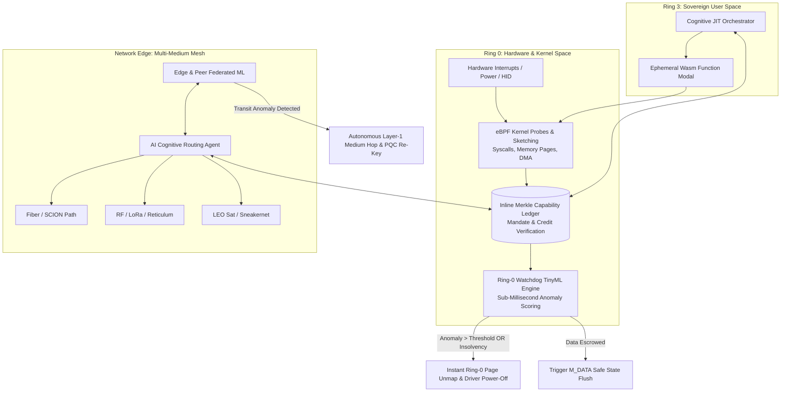
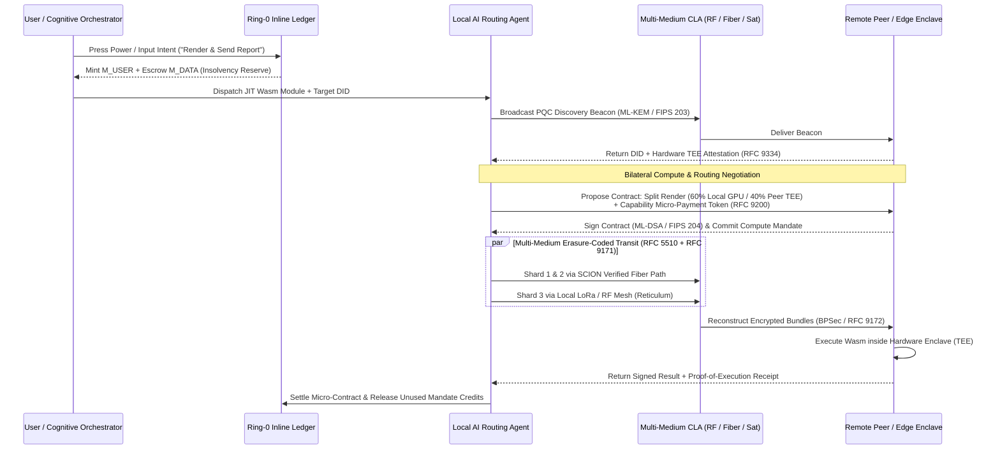
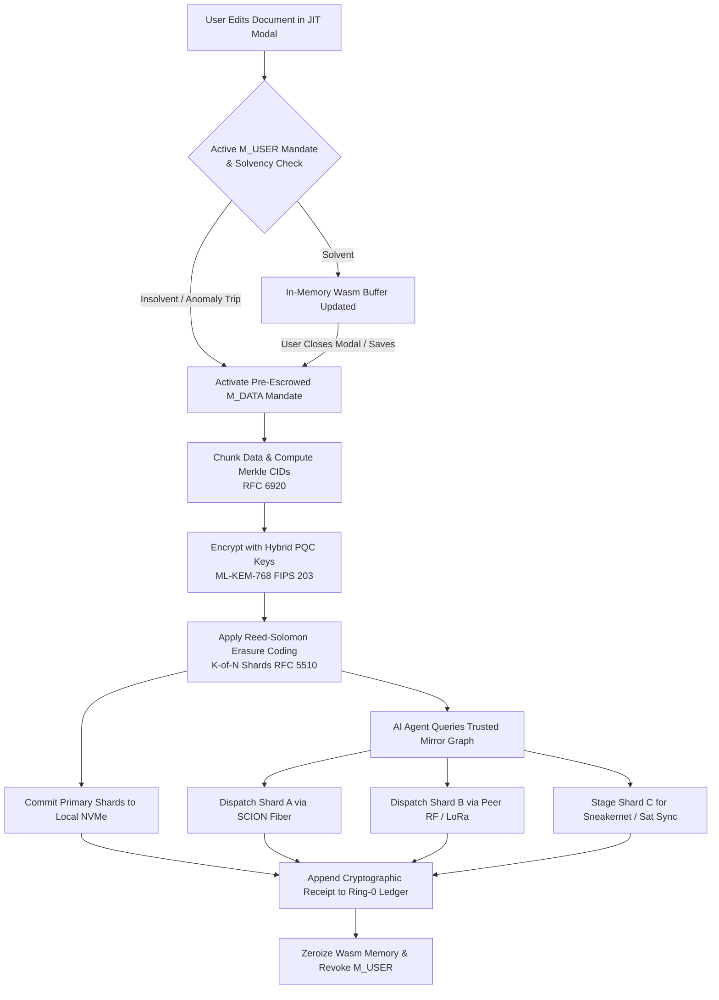

# Sovereign Mandate OS & Multi-Medium Adaptive Mesh (SMAM-OS)
## End-to-End Cryptographic Compute, Capability-Funded Execution & Cognitive Mesh Specification

**Status:** Draft Comprehensive Architecture Blueprint  
**Date:** November 2026  
**Scope:** Ring-0-to-Mesh Zero-Trust Operating System, Mandate-Driven Capability Ledger, JIT Orchestrator & Multi-Medium Cognitive Network  
**Purpose:** A starting spec to explore options for improved network and compute architectures in an AI-enabled ecosystem, accounting for novel security, availability, sovereignty, and provenance needs.
---

## 1. Executive Summary & Core Paradigm Shift
Legacy computing stacks—from monolithic operating systems (POSIX/Windows) to static perimeter networks (TCP/IP/BGP)—were engineered around **implicit ambient authority**. Once a user logs in or a process spawns, software inherits broad access to CPU cycles, memory, drivers, and network sockets. Simultaneously, modern applications remain trapped in rigid, bloated silos ("email apps," "paint apps") that waste compute and expose massive static attack surfaces.

**SMAM-OS** unifies the local operating system and the global network into a single, **user-mandate-driven, cryptographically metered architecture**. 

### Core Architectural Tenets
1. **Zero Ambient Authority (Mandate-Driven Execution):** No hardware component, Ring-0 driver, memory page, or network socket may execute without an active, cryptographically signed **Mandate** backed by a finite **Compute & Energy Budget**.
2. **Inline Ring-0-to-Ring-3 Distributed Capability Ledger:** Every syscall, IPC message, storage write, and packet dispatch is recorded and settled against an ultra-low-latency, eBPF-enforced micro-ledger spanning kernel space to user space.
3. **Ephemeral JIT Orchestration (Death of the Monolithic App):** Users do not launch static applications. Users interact with a local **Cognitive Orchestrator** that compiles, sandboxes (WebAssembly/Micro-VMs), and executes Just-In-Time (JIT) functional modals tailored to immediate user intent—remixing, securing, and garbage-collecting them when the mandate expires.
4. **End-to-End Autonomous Watchdog & Edge ML:** A continuous AI/ML telemetry pipeline monitors execution from hardware interrupts (Ring 0) to RF/fiber packet framing (Layer 1), autonomously severing or shifting anomalous components *before* maliciousness is proven.
5. **Sovereign Multi-Medium Mesh:** When local execution requires remote data or compute, the local Cognitive Routing Agent negotiates bilateral compute contracts and stripes PQC-encrypted, erasure-coded bundles across heterogeneous Layer-1 mediums (fiber, LoRa/RF, LEO satellite, optical, sneakernet).

---

## 2. The Mandate Economy & Inline Ring-0-to-Ring-3 Ledger

In SMAM-OS, **compute, storage, power, and bandwidth are scarce, explicitly budgeted resources**. Every execution path requires both cryptographic authorization (a Mandate) and solvency (allocated Compute/Storage Credits).

### 2.1 Taxonomy of Mandates
All system activity traces back to one of four cryptographically signed Mandate classes, rooted in hardware attestation ([RFC 9334](https://www.rfc-editor.org/rfc/rfc9334.html) - RATS) and capability-based security principles ([Object-Capability Model](https://en.wikipedia.org/wiki/Object-capability_model) / [RFC 9200](https://www.rfc-editor.org/rfc/rfc9200.html) - ACE-OAuth):

| Mandate Class | Origin & Trigger | Scope & Authority | Solvency & Lifecycle Rules |
| :--- | :--- | :--- | :--- |
| **1. User Mandate (`M_USER`)** | Physical hardware interrupts (Power button press, HID keystroke, biometric/hardware token tap). | Root authority. Authorizes hardware power-up, HID driver initialization, and JIT function spawning. | Funded directly by the user's sovereign master key. Revoked immediately upon explicit user termination or idle timeout. |
| **2. System Mandate (`M_SYS`)** | Boot firmware / Root of Trust ([TPM 2.0](https://trustedcomputinggroup.org/resource/tpm-library-specification/) / Secure Enclave). | Minimal Ring-0 kernel core, memory allocator, eBPF verifier, and Watchdog ML engine. | Pre-allocated baseline reserve fund. Strictly capped; cannot spawn user-space network sockets without `M_USER`. |
| **3. Event Mandate (`M_EVT`)** | Kernel scheduler ticks, hardware interrupts (NIC/RF packet arrival), or authorized IPC signals. | Ephemeral execution slices for interrupt handlers, packet routing, or background garbage collection. | Micro-funded via sub-mandate delegation from a parent `M_USER` or `M_SYS`. Terminates instantly upon event completion. |
| **4. Data Mandate (`M_DATA`)** | State persistence triggers (e.g., user closes a drafted document, database commit, or shard sync). | Authorizes storage I/O, erasure coding ([RFC 5510](https://www.rfc-editor.org/rfc/rfc5510.html)), and cryptographic mirror replication. | **Insolvency-Protected Escrow:** Automatically carves out a protected micro-fund escrow *before* process teardown so critical user data persists safely even if the parent process runs out of compute budget or crashes. |

### 2.2 Inline Ring-0-to-Ring-3 Ledger & eBPF Enforcement
Rather than slow blockchain consensus, the OS ledger is an **append-only, hash-chained Merkle Directed Acyclic Graph (DAG)** maintained in shared, read-only Ring-0 memory pages, updated via **eBPF (Extended Berkeley Packet Filter)** kernel probes ([RFC 9657](https://www.rfc-editor.org/rfc/rfc9657.html)) and hardware performance counters.

* **Cold-Boot Sequence:**
  1. **Physical Power Button Press** generates a hardware interrupt -> mints root `M_USER (Boot)`.
  2. Kernel initializes **only** Ring-0 core, eBPF ledger, Watchdog ML, and minimal HID (keyboard/touch/voice) drivers. Wi-Fi, Bluetooth, GPU shaders, and storage arrays remain **unpowered/unmapped** until a specific `M_USER` funds them.
  3. System enters low-power `WAIT_FOR_INTENT` state until HID input arrives.
* **Insolvency & Runaway Protection:** If a JIT function enters an infinite loop, attempts unauthorized privilege escalation, or suffers a supply-chain compromise, its allocated Compute Budget drains in milliseconds. Upon hitting `0 Credits` (Insolvency), the Ring-0 eBPF scheduler **immediately unmaps its memory pages and powers down its associated drivers**—unless a pre-escrowed `M_DATA` triggers to safely flush unsaved user state to encrypted storage.

---

## 3. Cognitive JIT Orchestrator (Ring 3 User Experience)

SMAM-OS eliminates pre-installed, monolithic applications. There is no "email client," "spreadsheet app," or "image editor" sitting on disk waiting to be exploited.

### 3.1 Just-In-Time (JIT) Functional Synthesis
1. **Intent Capture:** The user expresses intent via text, voice, or gesture inside the **Cognitive Orchestrator** (e.g., *"Draft an email to Alice about the Q4 mesh deployment and attach the telemetry chart"*).
2. **Mandate Minting:** The Orchestrator derives a scoped, time-bound `M_USER` sub-mandate granting access **only** to: (a) Alice’s public DID/key, (b) the specific CID ([RFC 6920](https://www.rfc-editor.org/rfc/rfc6920.html)) of the telemetry chart, and (c) outbound bundle dispatch.
3. **Ephemeral Modal Compilation:** The Orchestrator synthesizes a lightweight **WebAssembly (Wasm)** ([W3C WebAssembly Core](https://www.w3.org/TR/wasm-core-2/)) UI modal and logic module in memory.
4. **Dynamic Feature Mutation:** If the user says, *"Add a quick sketch pad so I can draw the topology,"* the Orchestrator hot-swaps a verified Wasm canvas module into the live modal, minting a temporary GPU/HID sub-mandate.
5. **Real-Time Remixing & Hardening:** Verified functional modules are content-addressed (CIDs), saved to the user's local sovereign library, continuously audited by background ML fuzzers, and shareable across the mesh as signed, deterministic code blocks.
6. **Clean Teardown:** Once the user sends the message or closes the modal, `M_DATA` commits any persistent artifacts to sharded storage, the Wasm sandbox is zeroed out, and all associated hardware/network mandates are revoked.

---

## 4. End-to-End Autonomous Watchdog & Edge ML Pipeline

Security does not rely on static signatures, CVEs, or human SOC triage. An end-to-end ML pipeline runs continuously from Ring 0 to the network edge, acting on **statistical anomaly thresholds** before maliciousness is confirmed.

### Multi-Tier Autonomous Reflexes
* **Tier 0 (Hardware/Ring-0 Watchdog):** TinyML models analyze syscall n-grams, cache-miss entropy, and DMA bursts directly inside kernel space. Anomalous patterns trigger immediate **capability throttling** or **sandbox vaporization**.
* **Tier 1 (Insolvency & State Preservation):** If an anomaly drains a module's mandate budget, `M_DATA` preserves user work in an isolated encrypted enclave while the compromised Wasm instance is destroyed and re-synthesized from clean golden weights.
* **Tier 2 (Network Edge & Transit Flux):** Edge ML monitors packet timing, RF noise floors, and peer attestation health. If a fiber backbone or RF relay exhibits anomalous latency or BGP/routing drift, traffic shifts instantaneously to alternate Layer-1 mediums.

---

## 5. Bilateral Compute Negotiation & Multi-Medium Routing

When a JIT function requires external data or heavy computation (e.g., rendering a complex 3D simulation or querying a remote dataset), SMAM-OS avoids centralized cloud monopolies and untrusted single pipes.

### 5.1 End-to-End Compute & Bandwidth Contract Flow
Endpoints negotiate **who pays for compute and where code executes** before transferring payload bytes:

### 5.2 Layer-1 Agnostic Bundle Transport & Sovereign Mirrors
* **Content-Addressed Storage ([RFC 6920](https://www.rfc-editor.org/rfc/rfc6920.html)):** Data is broken into Merkle-linked chunks identified solely by cryptographic hashes (CIDs).
* **Delay-Tolerant Bundle Protocol ([RFC 9171](https://www.rfc-editor.org/rfc/rfc9171.html) & [RFC 9172](https://www.rfc-editor.org/rfc/rfc9172.html)):** Payloads are encapsulated into self-contained, PQC-encrypted bundles capable of traversing high-speed fiber, intermittent RF/LoRa links, LEO satellites, or physical courier storage drives without session drops.
* **Path-Aware Sovereignty (SCION & Web-of-Trust):** The AI Routing Agent evaluates the user's sovereignty directives (e.g., *"Route only through personal Web-of-Trust peers ([RFC 4880](https://www.rfc-editor.org/rfc/rfc4880.html)) or jurisdiction-compliant SCION autonomous systems; never traverse ISP X"*).

---

## 6. Complete Data Lifecycle & Insolvency-Safe Persistence

The following workflow illustrates how user data survives anomalies, network blackouts, and process insolvency end-to-end:

---

## 7. Cryptographic & Protocol Reference Matrix

To ensure post-quantum durability and interoperability across constrained RF links and high-speed backbones, SMAM-OS mandates the following standards:

| Architectural Component | Standard / Specification | Role in SMAM-OS |
| :--- | :--- | :--- |
| **Store-and-Forward Transport** | **[RFC 9171](https://www.rfc-editor.org/rfc/rfc9171.html)** (Bundle Protocol v7) | Layer-1-agnostic framing across fiber, RF, satellite, and physical media. |
| **Bundle End-to-End Security** | **[RFC 9172](https://www.rfc-editor.org/rfc/rfc9172.html)** (BPSec) | Integrity and confidentiality of bundles across untrusted intermediate hops. |
| **Multi-Path Erasure Coding** | **[RFC 5510](https://www.rfc-editor.org/rfc/rfc5510.html)** (Reed-Solomon FEC) | Splitting data into K-of-N shards striped across disjoint physical mediums. |
| **Content-Addressed Naming** | **[RFC 6920](https://www.rfc-editor.org/rfc/rfc6920.html)** (ni: Hash URIs) / IPLD | Location-independent data retrieval from any verified peer mirror. |
| **Post-Quantum Key Exchange** | **[NIST FIPS 203](https://csrc.nist.gov/pubs/fips/203/final)** (ML-KEM / Kyber) | Quantum-resistant key encapsulation for node handshakes and data at rest. |
| **Post-Quantum Signatures** | **[NIST FIPS 204](https://csrc.nist.gov/pubs/fips/204/final)** (ML-DSA / Dilithium) | Signing user mandates, JIT Wasm modules, ledger entries, and contracts. |
| **Hardware & TEE Attestation** | **[RFC 9334](https://www.rfc-editor.org/rfc/rfc9334.html)** (RATS Architecture) | Verifying remote peer enclave integrity before offloading compute workloads. |
| **Capability Authorization** | **[RFC 9200](https://www.rfc-editor.org/rfc/rfc9200.html)** (ACE-OAuth) | Lightweight cryptographic capability tokens for micro-contracts and mandates. |
| **Kernel & Network Telemetry** | **[RFC 9657](https://www.rfc-editor.org/rfc/rfc9657.html)** / Linux eBPF | Line-rate syscall, memory, and packet sketching for autonomous anomaly reflex. |
| **Backbone Path Steering** | **[RFC 8986](https://www.rfc-editor.org/rfc/rfc8986.html)** (SRv6) & **SCION** | Cryptographically verified path selection, replacing blind BGP ([RFC 4271](https://www.rfc-editor.org/rfc/rfc4271.html)). |
| **Self-Sovereign Identity** | **[W3C DID Core](https://www.w3.org/TR/did-core/)** & **[RFC 4880](https://www.rfc-editor.org/rfc/rfc4880.html)** | User-controlled identity and personal Web-of-Trust routing directives. |
| **Sandboxed JIT Execution** | **[W3C WebAssembly](https://www.w3.org/TR/wasm-core-2/)** & Micro-VMs | Deterministic, memory-safe execution of ephemeral, AI-synthesized functions. |

---

## 8. Phased Engineering Blueprint (From Concept to Silicon)

Building SMAM-OS does not require waiting for clean-slate hardware; it can be bootstrapped incrementally atop existing open-source primitives:

1. **Stage 1 — Capability-Metered Microkernel & eBPF Ledger:**
   * Modify a minimalist kernel (e.g., **seL4** microkernel or a stripped **Linux kernel** with strict **eBPF LSM** hooks) so all driver bindings and `mmap` allocations require a signed capability token checked against a shared-memory Merkle log.
2. **Stage 2 — JIT Wasm Orchestrator Shell:**
   * Replace the traditional desktop environment with a minimal Wayland/framebuffer compositor hosting a local quantized LLM + **Wasmtime** runtime that compiles and hot-loads signed Wasm UI modals on demand.
3. **Stage 3 — Multi-Medium Convergence Layer Daemon:**
   * Integrate **Reticulum** and **BPv7 ([RFC 9171](https://www.rfc-editor.org/rfc/rfc9171.html))** adapters across Wi-Fi, Ethernet, LoRa USB transceivers, and removable block devices, governed by a local policy-routing agent.
4. **Stage 4 — Watchdog TinyML & Bilateral Contract Engine:**
   * Train lightweight autoencoder/transformer anomaly detectors on clean kernel syscall/network sketches, wiring high-confidence anomaly outputs directly to eBPF map revocations and `M_DATA` escrow triggers.
